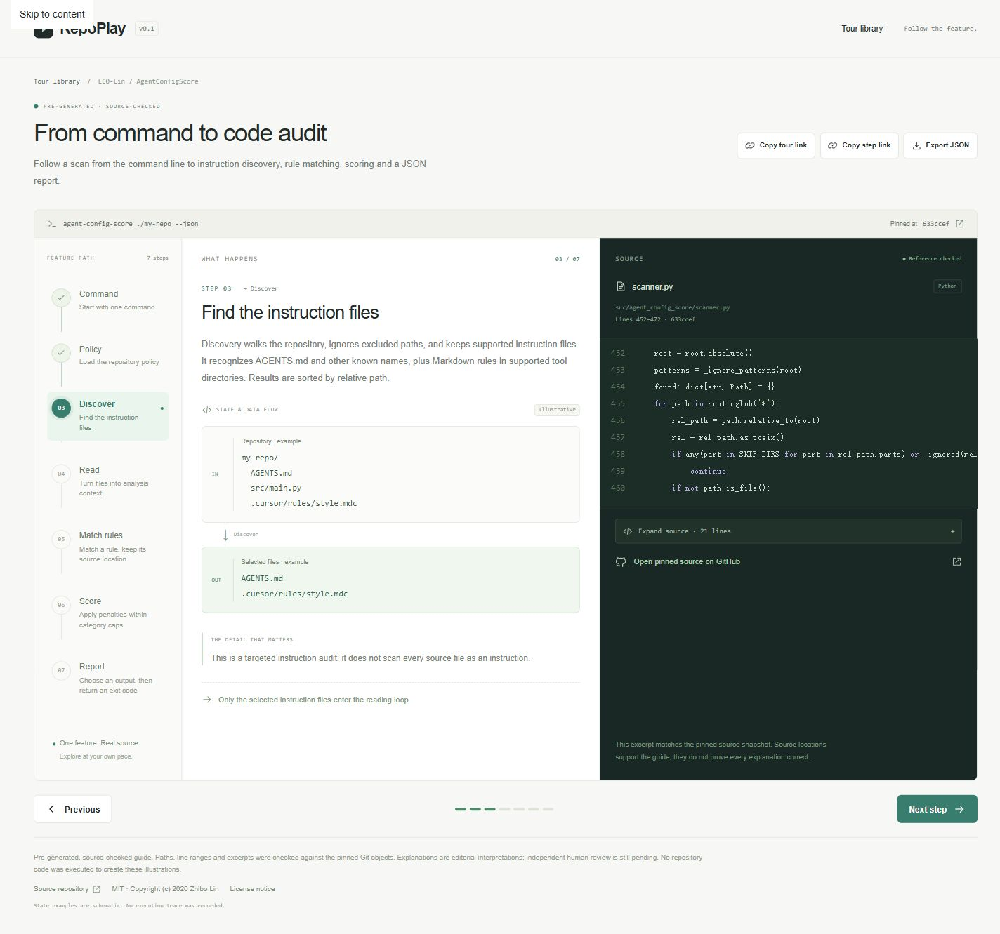

# RepoPlay

**Understand a codebase, one step at a time.**

[中文体验说明：做了什么、怎么体验、还缺什么](START_HERE.zh-CN.md)

Follow a concrete feature from input to output. Each step connects an explanation, an explicitly illustrative state diagram, and the real code at a fixed GitHub commit. Start with a ready-made tour; no account, API key, or CLI installation is required to explore it.

RepoPlay is the working name of this local v0.1. Domain, package name, and trademark availability have not been checked. Its discovery → shared tour → project interest hypothesis has not been validated with real users or Stars.



Actual local interface captured on 2026-10-07. [Homepage](docs/screenshots/home-desktop.jpg) · [Mobile source panel](docs/screenshots/mobile-source.jpg).

Additional actual views: [End-of-tour continuation](docs/screenshots/tour-ending.jpg) · [Mobile continuation](docs/screenshots/mobile-ending.jpg).

## Run locally

Requires Node.js **20.9 or newer** and npm. Developed and verified with Node.js 24.11.1 on Windows. Dependencies are recorded in `package-lock.json`.

```sh
cd repoplay
npm ci
npm run dev
```

Open [http://127.0.0.1:3000](http://127.0.0.1:3000). For a production preview:

```sh
npm run build
npm start
```

Both commands bind to loopback by default. Stop the development server before starting production on the same port. Built-in tours work without GitHub or model access after dependencies are installed.

## Explore a feature

- Click **Try the interactive demo** on the homepage.
- Use Previous / Next, click a path node, or use the progress markers.
- Read the input and output illustrations alongside the source. “Illustrative” means schematic data, not an observed execution trace.
- Expand source, switch between references, and open the exact GitHub lines at the pinned commit.
- Copy a tour or step link. The share field also exposes the exact URL for manual copying when clipboard access is restricted. Refresh and browser history preserve the selected step.
- On mobile, switch between **Path**, **Step**, and **Source**; code scrolls within its panel. The tab row supports Left/Right and Home/End keys. Selecting another step returns to its explanation.
- At the final scan step, compare JSON and terminal output, with a source reference for each branch.
- At the end of a sample path, open another feature or return to the tour library. Switching guides starts the new path at its first step; browser Back restores the previous URL step.

Sample URLs use `/tour/<id>?step=<step-id>`. They can be shared when the same application origin is reachable by the recipient. A localhost URL is only usable on that local machine.

## Included tours and sources

All three guides use **AgentConfigScore** at commit [`633ccef39a89ba79592d90a68f5410f57bb8bb53`](https://github.com/LE0-Lin/AgentConfigScore/commit/633ccef39a89ba79592d90a68f5410f57bb8bb53).

| Tour | Feature | Steps |
| --- | --- | --- |
| `scan-to-report` | Command → policy → discovery → reading → rules → score → report | 7 |
| `rule-lookup` | Command dispatch → argument parsing → catalog lookup → ID guard → explanation | 5 |
| `auditable-exception` | Configuration → validation → thresholds → exception → audit trail | 5 |

These are **pre-generated, source-checked guides**, not tours generated after a visitor clicks. The development agent reviewed the selected paths and explanations, checked each exact excerpt and line range against committed Git objects, and verified snapshot Git blob hashes. **Independent human editorial review is still pending.** Correct source locations do not prove an explanation is correct or complete. The guides intentionally omit most of the repository and are not runtime traces.

AgentConfigScore is MIT licensed, copyright (c) 2026 Zhibo Lin. Its full notice is preserved in [docs/AgentConfigScore-LICENSE.txt](docs/AgentConfigScore-LICENSE.txt), served at `/notices/AgentConfigScore-LICENSE.txt`, and linked in the sample player. The adjacent source checkout was read only; its uncommitted changes are excluded. RepoPlay code is independently contained in this directory.

## Tour format

Built-in and model-generated tours use the same `Tour` format and player. `schemaVersion: 1` includes:

- `repository`: owner, name, full 40-character commit, license description;
- title, summary, feature command, language and editorial provenance;
- `dataMode: "illustrative"` (v0.1 has no execution collector);
- 5–8 ordered steps, with stable IDs, explanation, insight, input/output state, transition and exact source references;
- exactly one connection between each consecutive step, and optional source-backed branch illustrations (not additional graph edges).

A `TourDocument` wraps `{ tour, files }`. Each source file includes a repository-relative path, its full UTF-8 text and Git blob SHA. This makes JSON export/import self-contained.

The authoritative runtime schema is [lib/tour.ts](lib/tour.ts). Structural schemas are published in [docs/tour.schema.json](docs/tour.schema.json) and [docs/tour-document.schema.json](docs/tour-document.schema.json). Runtime validation additionally checks unique IDs, ordered connections, byte budgets, source existence, exact one-based line ranges and excerpt equality. Server-side document imports also recompute blob hashes.

Imported JSON is always relabeled **local / unreviewed**. Matching its included hashes and references cannot establish that those files came from the asserted upstream commit. React renders imported text as text, never HTML or executable code. Future generation uses the same validation and renderer.

## Bounded public repository import

The homepage accepts `owner/repo`, `github.com/owner/repo`, or `https://github.com/owner/repo` (optionally `.git`). Only public GitHub repositories are supported. Arbitrary sites, credentials in URLs, ports, query strings and file/tree URLs are rejected. The backend constructs every GitHub API URL itself and rejects redirects.

An import reads metadata, resolves the default branch to a fixed commit, reads a bounded Git tree and prioritizes entry points, `src/` files and the README. It does not download an archive, install dependencies, clone into a runnable checkout, or execute repository code.

| Boundary | Limit |
| --- | --- |
| GitHub reported repository size | 20,000 KB |
| Tree entries | 2,000; truncated trees rejected |
| Retained text files | 12 |
| Individual file | 48,000 bytes |
| Total decoded source read, including excluded content | 256,000 bytes |
| Blob fetch attempts | 24 |
| Entire GitHub operation | 20 seconds |
| Tree response | 1,000,000 bytes |
| Local Tour JSON request | 1,000,000 bytes |
| URL-encoded local export form | 3,000,000 bytes; decoded Tour remains schema-bounded |
| Reading a submitted JSON or export form body | 5 seconds; timeout cancels the reader |

Binary or invalid UTF-8 content, symlinks, submodules, dependency folders, generated output, lock files and conventional credential files are excluded. Common credential-shaped content is also excluded. These heuristics are bounded filters, not a guarantee that all sensitive material is recognized. A public repository may contain additional sensitive data; inspect it before enabling model transmission. Rate limits, large repositories, missing source and timeouts have explicit product messages.

With no model configuration, a successful import shows the pinned commit and the files actually read, then states **new tour generation is not configured**. It does not invent a tour or analysis progress. The included tours remain fully usable.

## Optional server-side model adapter

Copy `.env.example` to `.env.local` and configure only project-specific values. Secrets never use the `NEXT_PUBLIC_` prefix.

```dotenv
REPOPLAY_GITHUB_TOKEN=
REPOPLAY_MODEL_ENDPOINT=https://your-provider.example/v1/chat/completions
REPOPLAY_MODEL_NAME=your-model
REPOPLAY_MODEL_API_KEY=your-key
```

The endpoint is the full **OpenAI-compatible chat/completions URL**, using JSON-object responses. HTTPS is required except for loopback HTTP. All three model values are required. Restart the server after changing them; rebuild for production so the homepage configuration notice agrees with the server.

[lib/model.ts](lib/model.ts) exposes the replaceable `ModelAdapter` interface. Its HTTP implementation has a 45-second timeout, bounded response size and output token limit. Submitting a new repository with model configuration sends the selected public source to that operator-configured provider and may incur provider charges. Repository text is treated as untrusted data in the prompt; the adapter provides no tools or source-code execution. Model output must match the Tour schema and the imported owner/repository/commit; all excerpts must match the selected files exactly. Invalid output is rejected. Accepted explanations remain **unreviewed**.

No paid model was called during development or validation. Adapter success, invalid output, rate limits and transport errors were tested using offline fixtures. Provider compatibility, generation quality and real usage costs require an explicitly configured trial.

Generated and imported documents are kept in **sessionStorage in the current browser tab**. Export JSON to share; another person can import it from the homepage. There is no public persistence service or fabricated public URL for these documents. Clearing storage or closing the tab removes the local copy; downloads remain yours.

Malformed JSON, invalid source references, unreadable responses and unavailable browser storage produce recovery guidance. Choose another JSON file or open the built-in tour. Local restore revalidates structure and references and labels the copy unreviewed; it never restores editorial trust from browser storage.

## Verify

```sh
npm run typecheck
npm test
npm run verify:samples
npm run build
```

With an unconfigured model and a running local app, optional HTTP smoke checks:

```sh
node scripts/verify-local.mjs
```

The smoke script refuses to run against a model-enabled homepage. Tests focus on schema/reference integrity, trusted host parsing, read budgets, excluded content, Git blob integrity, error handling and offline model adapters. See [docs/VERIFICATION.md](docs/VERIFICATION.md) for browser observations and remaining verification limits.

## Project layout

```text
app/                 Homepage, player routes and server endpoints
components/          Responsive Tour player and product UI
data/                Three editorial Tour JSON files and pinned source snapshot
lib/tour.ts          Strict format, reference validator and source URL builder
lib/github.ts        Bounded public GitHub importer
lib/model.ts         Replaceable generation adapter
tests/               Offline format, import and model boundary tests
docs/                Source notice, exported schemas and verification record
```

To add a guide, create a Tour JSON and source snapshot, register it in `lib/samples.ts`, and run the reference checks. `scripts/make-samples.mjs` is an optional editorial regeneration helper that requires the adjacent AgentConfigScore checkout with the pinned commit; it is never used by the application or build.

## Before a public release

See [RELEASE_CHECKLIST.md](RELEASE_CHECKLIST.md). This delivery performs no repository creation, push, deployment, public posting or purchase. The GitHub Star button is absent until `NEXT_PUBLIC_REPOPLAY_REPOSITORY` is set to a real RepoPlay repository URL. It never points to the source project.

For a suggested 90-second screen recording, see [docs/DEMO_SCRIPT.md](docs/DEMO_SCRIPT.md). It uses the built-in guide and needs no provider configuration.
